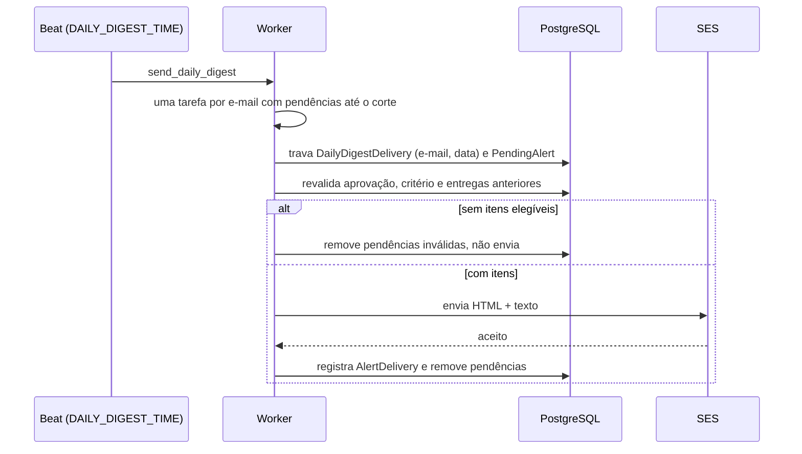

# Alertas por e-mail

Guia de uso e operação. As decisões estão na
[ADR-005](decisions/005-sistema-de-alertas.md); os templates, em
[`apps/subscriptions/emails/README.md`](../apps/subscriptions/emails/README.md).

## Ciclo de vida da inscrição

1. `POST /api/v1/subscriptions/` cria inscrições inativas com
   `accepted_terms_at` e enfileira o e-mail de confirmação. Pedidos anteriores
   ainda não confirmados do mesmo endereço são descartados; inscrições já
   confirmadas continuam valendo até a nova confirmação.
2. `GET /api/v1/subscriptions/confirm/{token}` aceita apenas pedidos nunca
   confirmados e criados há menos de `SUBSCRIPTION_CONFIRM_TTL_HOURS` (48 h).
   Ativa o pedido, substitui as inscrições confirmadas anteriores do endereço e
   transfere o histórico de entregas para a nova inscrição, sem repetir
   proposições já enviadas. Redireciona para
   `{PUBLIC_SITE_URL}/?subscription=confirmado` (ou `invalido`).
3. `GET /api/v1/subscriptions/unsubscribe/{token}` desativa todas as inscrições
   do endereço e redireciona para `{PUBLIC_SITE_URL}/alertas/cancelado?status=ok`
   (ou `invalido`). Um link de confirmação antigo não reativa o endereço.
4. `cleanup_unconfirmed_subscriptions` (04:00) apaga pedidos nunca confirmados
   criados há mais de 48 h. Inscrições canceladas são mantidas, com histórico e
   link de cancelamento válidos.

Tokens: `secrets.token_urlsafe(48)`, únicos.

## Requisição de criação

```json
{
  "email": "pessoa@exemplo.org",
  "accepted_terms": true,
  "alerts": [
    {
      "frequency": "daily",
      "ast": {
        "op": "AND",
        "children": [
          {"field": "categoria", "op": "in", "value": ["educacao_cultura", "saude"]},
          {"field": "casa", "op": "eq", "value": "camara"},
          {"field": "quiteriometro", "op": "gte", "value": 5}
        ]
      }
    }
  ]
}
```

Retorna 201 com `[{id, email, frequency, is_active, created_at, confirmed_at}]`.
Retorna 422 se `alerts` estiver vazio, `accepted_terms` for falso, a frequência
for desconhecida ou o AST não compilar; 429 acima do limite por IP.

`weekly` ainda é aceito, mas só inscrições `daily` recebem e-mails.

## Critérios (AST)

Nós lógicos: `{"op": "AND"|"OR", "children": [...]}` e
`{"op": "NOT", "child": {...}}`. Use maiúsculas: o avaliador de revalidação não
aceita minúsculas.

Folhas: `{"field": ..., "op": ..., "value": ...}` com `op` em `eq`, `ne`, `in`
(lista), `contains`, `gt`, `gte`, `lt`, `lte`, `between` (`[min, max]`).

| Campo | Origem no documento da proposição |
| --- | --- |
| `tipo` | `type_code` (ex.: `pl`) |
| `casa` | `camara` ou `senado` |
| `situacao` | `current_status` normalizado |
| `ano` | Ano (numérico, 2000–2030) |
| `proposicao` | ID interno |
| `autor` | IDs de parlamentares autores |
| `partido`, `genero`, `raca`, `religiao`, `estado` | Mandato atual de cada autor |
| `relator` | IDs dos relatores atuais |
| `tema` | Slugs de `Theme` |
| `categoria` | Categorias das anotações; sem anotação, a categoria da QuitérIA concluída |
| `comissao` | Siglas de comissões |
| `frente`, `bancada` | Nomes normalizados de frentes/bancadas atuais |
| `norma` | `lei_{numero}_{ano}` ou o tipo normalizado |
| `quiteriometro` | `round(score × 10)`, de -10 a 10; ausente sem análise, então filtros por faixa não casam |

Valores são normalizados (minúsculas, sem acento, caracteres reservados → `_`)
e viram tokens `campo_valor`, como `casa_camara`. Campos numéricos geram
tokens de faixa (`quiter_ge_5`, `ano_le_2024`). `contains` é igualdade de token,
não busca por substring.

### Validação

A API e o formulário de teste do admin recusam (422 / erro de formulário):

- nó vazio ou sem operador, e `AND`/`OR` sem filhos;
- campo fora da tabela acima ou operador desconhecido;
- `in` sem lista não vazia e `between` sem `[mínimo, máximo]`;
- `gt`, `gte`, `lt`, `lte` e `between` em campos não numéricos;
- valor composto em operadores de valor simples.

Conectivos são aceitos em qualquer caixa. Inscrições já gravadas não são
recompiladas.

O compilador grava a consulta em `Subscription.query` e marca
`needs_revalidation` quando há `ne`, `NOT`, comparação/faixa ou `eq` numérico.
Nesses casos, depois do `tsquery`, o avaliador Python
(`reference_matcher.py`) confirma o resultado.

## Correspondência

Gatilhos (após o commit), que chamam `match_and_notify`:

- proposição criada já aprovada ou que passa a `is_approved=True` via `save()`
  (o admin usa `save()`; `QuerySet.update()` não dispara signals);
- qualquer gravação de `PropositionAnnotation`;
- classificação QuitérIA concluída fora do backfill.

Para cada inscrição diária ativa cujo critério corresponde, e cujo endereço
ainda não recebeu a proposição (`AlertDelivery`), cria-se um `PendingAlert`
único por inscrição e proposição.

## Resumo diário



- Um e-mail por endereço por dia, mesmo com várias inscrições.
- Pendências criadas depois do corte ficam para o dia seguinte; as de dias
  anteriores são recuperadas.
- Tarefas atrasadas (data diferente do corte atual) ou executadas antes do corte
  saem sem enviar.
- `AnymailError` tem retry com backoff, até 5 vezes; outras exceções não.
- Assunto: `[Elas no Congresso] Resumo do dia: N proposição(ões)`.
- Itens agrupados por categoria (anotação humana, depois QuitérIA; senão
  "Sem tema informado") e, dentro dela, por celeridade.

SES e PostgreSQL não compartilham transação: uma queda depois do aceite do SES
e antes do commit pode reenviar a mensagem.

## Alerta de teste no admin

Em **Inscrições → (inscrição ativa) → Enviar alerta de teste** (exige permissão
de alteração): informe o ID da proposição, um AST (preenchido com o da inscrição,
não salvo) e confirme. O envio só acontece se o AST corresponder à proposição
pela mesma lógica de produção; o assunto recebe `[TESTE]` e nada é registrado em
`AlertDelivery`.

## Tarefas

Todas em `apps.subscriptions.tasks`, na fila `celery`:

| Tarefa | Função |
| --- | --- |
| `match_and_notify` | Avalia uma proposição contra as inscrições e cria pendências |
| `send_alert_email` | Cria a pendência para uma inscrição (nome legado) |
| `send_daily_digest` | Disparada pelo Beat; distribui por endereço |
| `send_daily_digest_email` | Envia o resumo de um endereço |
| `send_confirmation_email` | E-mail de confirmação |
| `send_test_alert_email` | Alerta de teste do admin |
| `cleanup_unconfirmed_subscriptions` | Limpeza das 04:00 |
| `send_weekly_digest`, `send_digest_email` | Legadas: só registram log |

A migração `subscriptions/0006` desativa agendamentos semanais antigos no banco
do Beat.

## Configuração

`DAILY_DIGEST_TIME`, `SUBSCRIPTION_THROTTLE_RATE_PER_HOUR`, `SITE_BASE_URL`,
`PUBLIC_SITE_URL`, `AWS_SES_FROM_EMAIL`, `AWS_DEFAULT_REGION` e
`AWS_SES_ENDPOINT_URL`. Ver [configuracao.md](configuracao.md#alertas).

Em produção, o SES precisa estar fora do sandbox, com a identidade remetente
verificada; a instância EC2 usa uma IAM role com `ses:SendEmail` e
`ses:SendRawEmail`, sem chaves estáticas.
