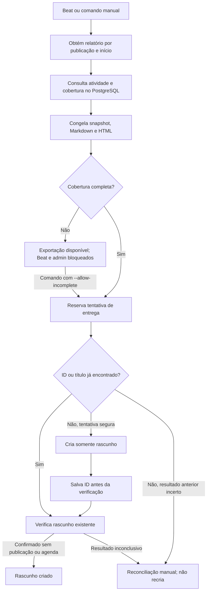

# ADR-001: Geração de rascunhos do Substack a partir de relatórios congelados

## Estado e contexto

**Implementada. Decisão original de 06/10/2026; consolidada em 08/10/2026.**
A ADR-002 substituiu o refresh semanal como origem rotineira da atualização.

A equipe precisa de um Radar com atividade legislativa oficial para revisão
editorial. Prepará-lo não pode publicar conteúdo, enviar e-mail ou sobrescrever
edições humanas. Falhas de rede durante a criação podem deixar incerto se o
rascunho já existe no serviço externo.

## Decisão

Manter `apps.newsletters` independente dos alertas. A preparação normal consulta
PostgreSQL e os checkpoints de ingestão; não chama as fontes oficiais, OCR ou IA.
Um refresh de históricos permanece disponível somente como recuperação explícita
pelo comando `weekly_newsletter --refresh`.

### Conteúdo e cobertura

A semana automática vai da segunda-feira anterior até a seguinte, com fim
exclusivo, em `America/Sao_Paulo`. O comando e o workflow também aceitam datas
manuais inclusivas, inclusive o dia atual. A seleção usa apresentação, eventos,
votações e promulgação datados, abrangendo proposições monitoradas ainda não
aprovadas para o painel público. Alterações de `updated_at` não são atividade.

O conteúdo reúne LEGENDA, destaques e Radars por casa, com ementa, identificação,
estágio, link oficial e autoria. Partido e UF da autoria são preservados no
snapshot; dados ausentes recebem indicação explícita. O estágio editorial é
calculado por regras determinísticas, separado da celeridade. A equipe escreve
a análise editorial no Substack; o fluxo não gera esse texto por IA.

`source_coverage` exige, por casa, baseline concluída, início de cobertura
compatível com o período, cobertura recente de até 26 horas, última execução
diária bem-sucedida sem erros e inventário reconciliado nos últimos oito dias.
A cobertura recente é medida em relação ao momento atual, mesmo para semanas
antigas.
Períodos ainda abertos usam o corte disponível da coleta, não uma promessa de
cobertura das publicações futuras daquele dia. OCR e IA pendentes não bloqueiam
por si só a cobertura da atividade oficial.

### Persistência e entrega



`WeeklyReport` é único por publicação/data inicial; uma data final diferente para
a mesma chave é recusada. Depois de congelado, conteúdo não é regenerado
silenciosamente. A cobertura gravada também não é recalculada apenas por repetir
a entrega de um relatório já preparado. No Beat, o relatório só é congelado às
06:35 se a cobertura estiver completa; às 06:45 ele é congelado de qualquer
forma, com `is_complete=False` quando incompleto. Na recuperação por
`--refresh`, `is_complete` passa a indicar que todos os refresh retornaram `ok`,
e `source_coverage` não é consultado.

`deliver_report` reserva a tentativa em transação. Uma reserva inferior a dez
minutos impede concorrência; uma reserva vencida é tratada como resultado incerto.
A entrega procura o ID salvo ou o título exato, salva o ID antes de verificar e
não atualiza rascunhos existentes. Uma tentativa incerta não permite nova criação
cega; é possível vincular um ID localizado manualmente.

`DraftOnlyClient` isola `python-substack==0.9.1`. Depois da autenticação, aceita
apenas `GET` e o POST para `{publicação}/drafts`. A criação passa
`publish=False`, `prepublish=False`, `send=False` e `share_automatically=False`.
A verificação exige `draft_body`, ID correspondente e ausência de campos que
indiquem publicação ou agendamento.

### Configuração e operação implementadas

`WEEKLY_NEWSLETTER_ENABLED=False` é o padrão. A entrega exige
`SUBSTACK_COOKIES_STRING` com sessão autorizada, fornecida como segredo de
implantação. `SUBSTACK_PUBLICATION_URL` tem padrão
`https://elasnocongresso.substack.com` e precisa ser uma origem HTTPS sem
caminho, query ou fragmento. Com a agenda habilitada, às segundas-feiras
o Beat prepara às 04:00, verifica cobertura às 06:35, tenta entregar às 06:45 e
registra prazo excedido às 07:00, no fuso de São Paulo.

O workflow `newsletter-draft.yml` aceita `start_date`, `end_date` e `dry_run`.
Fora do `dry_run`, verifica autenticação antes de preparar e entrega com
`--deliver`, usando o host configurado no deploy. Exemplos do comando, sem executar nesta revisão:

```sh
python manage.py weekly_newsletter --check-auth
python manage.py weekly_newsletter --week-start 2026-09-28 --dry-run
python manage.py weekly_newsletter --week-start 2026-09-28 --deliver
python manage.py weekly_newsletter --report-id 12 --attach-draft-id 12345 --deliver
```

`--allow-incomplete`, disponível só no comando, é a exceção manual para entregar
com aviso de cobertura incompleta. O admin permite inspeção, exportação e nova
tentativa de entrega conforme as permissões, mas respeita o bloqueio de
cobertura. O status `delivered` significa rascunho criado, não publicação.
O guia operacional está em [newsletter.md](../newsletter.md).

## Alternativas e consequências

A exportação manual continua sendo a saída quando a integração falha. O adaptador
reduz o acoplamento aos endpoints internos usados pela biblioteca em comparação
com espalhar chamadas HTTP pelo domínio; não elimina a fragilidade dessa interface
nem a necessidade de renovar a sessão. Automação por navegador exigiria outro
runtime e dependência da interface visual.

Congelar o relatório preserva rastreabilidade e edições humanas, mas impede que
uma edição antiga absorva correções posteriores automaticamente. Cobertura
incompleta bloqueia a entrega automática; 07:00 é um objetivo operacional, sem
garantia de cumprimento diante de falhas das fontes ou atraso de fila.

## Referências da implementação

- [Model](../../apps/newsletters/models.py), [seleção e renderização](../../apps/newsletters/report.py) e [cobertura](../../apps/newsletters/freshness.py).
- [Serviço de entrega](../../apps/newsletters/service.py), [adaptador](../../apps/newsletters/substack.py) e [tarefas](../../apps/newsletters/tasks.py).
- [Comando](../../apps/newsletters/management/commands/weekly_newsletter.py), [workflow](../../.github/workflows/newsletter-draft.yml) e [testes](../../apps/newsletters/tests/).
- [ADR-002: ingestão e IA](002-daily-ingestion-content-versions.md).
