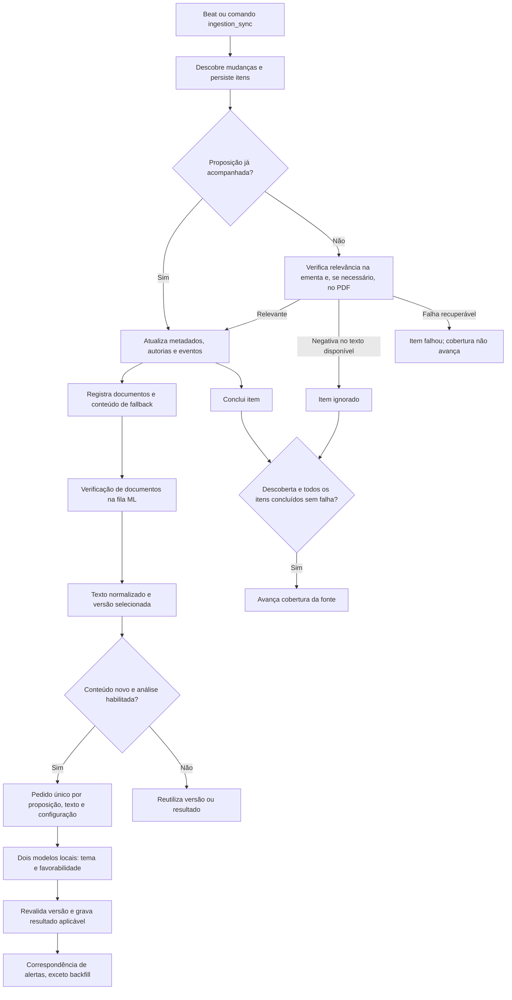

# ADR-002: Ingestão incremental dos raspadores e análise local por versão de texto

## Estado e contexto

**Implementada. Decisão original de 06/10/2026; consolidada em 08/10/2026.**
Substitui o refresh semanal de históricos originalmente descrito na ADR-001.

O banco precisa acompanhar mudanças oficiais sem refazer todo o inventário a
cada newsletter nem executar IA por alterações de status. As fontes podem falhar,
repetir itens ou corrigir documentos. A descoberta por palavras, a extração de
texto e a classificação por modelos têm responsabilidades distintas.

## Decisão

### Coleta e descoberta

Usar clientes `httpx` para as APIs oficiais e persistir `IngestionRun`,
`IngestionItem` e `IngestionCheckpoint`. A Câmara lista proposições por janela
de tramitação; o Senado usa `/processo?numdias=N&v=1`, incluindo encerrados, e
consulta processo/documentos. O client mantém endpoints legados para operações
auxiliares. `codigoMateria` continua como identidade quando disponível; sem ele,
o código usa o negativo do ID do processo e preserva o vínculo no payload.

A janela diária retoma a cobertura com sobreposição de dois dias; sem checkpoint,
começa 14 dias atrás. Uma execução que terminou em falha é reaproveitada no
disparo seguinte, sem nova descoberta, até que seus itens sejam concluídos.
A descoberta
persiste itens antes do processamento em lotes, dez por padrão. Somente descoberta
completa e itens sem falhas permitem avançar o checkpoint. Proposições conhecidas
são atualizadas sem reaplicar o filtro de descoberta, inclusive antigas e não
aprovadas; `is_approved` e anotações humanas não são substituídos pela coleta.

Para novas proposições, `theme_assert` consulta `RelevanceTerm` no banco, com
vocabulário padrão como fallback. Verifica palavras inteiras e expressões
completas, sem diferenciar caixa e preservando acentos; combinações explícitas
exigem todos os componentes; uma regra combinada sem ` + ` é tratada como
`termo + MULHER`. As ementas são verificadas primeiro: ementa e ementa detalhada
na Câmara; ementa do processo e da listagem no Senado. Sem correspondência,
tenta extrair o inteiro teor antes de descartar o item.

Sem link ou diante de CAPTCHA reconhecido, a descoberta decide só pelas ementas.
Erro de rede, PDF inválido ou texto vazio são falhas retomáveis, não evidência de
irrelevância. A exceção de CAPTCHA pertence à descoberta; a verificação assíncrona
de documentos tem seus próprios estados de falha.

A descoberta negativa pode baixar PDF e executar OCR de forma síncrona antes da
persistência. A extração/verificação posterior de documentos e a inferência são
enfileiradas em `ml`; portanto nem todo OCR ocorre fora do worker de coleta.

### Documentos e classificação

`PropositionDocument` guarda identidade, papel original/substitutivo, revisão,
validadores HTTP, hash de bytes e estado. `PropositionContentVersion` registra
texto, hash normalizado e proveniência. `current_content` seleciona a versão de
análise; `full_text` conserva o texto original. Substitutivos e redações integrais
identificáveis são elegíveis. Pareceres, relatórios e emendas sem texto integral
identificável não substituem automaticamente o conteúdo analisado.

Downloads usam ETag/Last-Modified quando disponíveis; bytes iguais reaproveitam
texto. O extrator usa `pypdf`; páginas com pouco texto podem usar PyMuPDF e
Tesseract em português. Sem OCR disponível, a extração degrada para `pypdf`.
Uma falha mantém a versão anterior e registra a tentativa malsucedida.

Pedidos de IA são únicos por proposição, hash de texto e configuração do modelo.
Mudança apenas de URL, status ou metadados não reclassifica texto idêntico.
A configuração inclui modelo, revisão e limiar; mudá-la torna os pedidos
pendentes `superseded` e exige reclassificação explícita.
Resultados existentes podem ser reutilizados. Antes e depois da inferência,
versão/configuração são verificadas para impedir aplicação de resultados antigos.
A baseline histórica registra conteúdo sem iniciar uma classificação em massa.

QuitérIA 2.0 executa dois modelos locais de classificação, com PyTorch/Transformers,
artefatos baixados no build e carregamento `local_files_only=True` no worker.
A revisão de `azmina/quiteria-2.0` está fixada nas configurações e no Dockerfile.
A entrada combina partido, gênero e UF da primeira autoria com o texto selecionado,
usando ementa como fallback; esses metadados não acionam novos pedidos isoladamente.

O modelo temático escolhe uma de dez categorias. O de favorabilidade usa a
probabilidade da classe desfavorável: a partir do limiar configurado, por padrão
`0.2254`, retorna `1` (desfavorável); abaixo retorna `0` (favorável). A entrada é
truncada em 512 tokens, sem sumarização ou análise de todas as páginas em blocos.
`QUITERIA_ENABLED=True` é o padrão, mas execução depende dos artefatos e do worker.

### Agenda, recuperação e backfill

Horários padrão do Beat em `America/Sao_Paulo`:

| Horário | Trabalho |
| --- | --- |
| 03:00 | Enriquecimento de perfis parlamentares |
| 06:00 / 06:10 | Ingestão incremental Câmara / Senado |
| 06:30 | Reconciliação do inventário: até 600 proposições por casa |
| 06:45 | Preparação de até 600 lacunas de avaliação |
| A cada 15 minutos | Recuperação de trabalho pendente, falho ou abandonado |

A tabela cobre a ingestão; a agenda completa, com alertas e newsletter, está em
[operacao.md](../operacao.md#agenda-do-celery-beat).

A reconciliação revisita registros sem verificação ou anteriores a sete dias,
incluindo checagem de documentos. O limite de 600 é diário; com `full_baseline`
(`bootstrap` e `catchup`) o teto é 100000 enquanto a baseline não termina.
Pedidos/documentos abandonados há 90 minutos podem ser retomados; a recuperação
automática limita tentativas a três e processa até 100 documentos e 100 pedidos
por execução.

`ingestion_sync` oferece `status`, `daily`, `bootstrap`, `retry` e `catchup`.
O feed do Senado é limitado a 30 dias. `catchup` zera todos os checkpoints,
remove `reconciled_at` de todas as proposições e enfileira ingestão e
reconciliação completa; reinicia a cobertura recente e audita o inventário
conhecido, sem afirmar continuidade sobre a lacuna nem recuperação de
proposições desconhecidas fora da janela. O guia operacional está em
[ingestao.md](../ingestao.md).

`classification_backfill` oferece `preview`, `status`, `queue` e `retry`. Usa
somente texto já armazenado e exclui qualquer anotação humana, revisão legada
ou avaliação com categoria válida e classificação 0/1. Pedidos marcados
`only_if_unevaluated` revalidam a ausência de avaliação antes/depois da inferência
e não disparam alertas retroativos. Enfileiramento bem-sucedido não significa
classificação concluída.

## Alternativas e consequências

Atualizar todo o inventário durante a newsletter repetia trabalho e misturava
coleta com entrega. Classificar a cada atualização repetia inferência sem mudança
substantiva. Checkpoints e versões reduzem esse custo, mas aumentam os estados
que precisam de inspeção e recuperação.

Correções silenciosas podem aguardar a reconciliação. O fallback por ausência de
link/CAPTCHA pode perder relevância presente só no PDF. Cobertura de atividade,
extração e IA são medidas separadas; nenhuma equivale a completude absoluta das
fontes. A truncagem do modelo limita o texto efetivamente considerado.

O banco é a referência dos dados. As cargas históricas por planilha já foram
aplicadas, e suas rotinas, junto com os crosswalks em CSV, foram removidas. O
enriquecimento de parlamentares identifica pessoas apenas por evidência oficial
persistida (mandatos e perfis por fonte), nunca só pelo nome. Uma pessoa sem
essa evidência gera novo cadastro, que precisa ser unificado manualmente se for
duplicata.

## Referências da implementação

- [Sincronização](../../apps/ingestion/sync.py), [clientes](../../apps/ingestion/clients/), [models](../../apps/ingestion/models.py) e [tarefas](../../apps/ingestion/tasks.py).
- [Relevância](../../apps/ingestion/theme_assert.py), [extração/OCR](../../apps/ingestion/fulltext.py) e [versões/pedidos](../../apps/ingestion/content.py).
- [Inferência QuitérIA](../../apps/propositions/quiteria.py), [backfill](../../apps/ingestion/classification_backfill.py), [configurações](../../config/settings/base.py) e [imagem](../../Dockerfile).
- [Comandos](../../apps/ingestion/management/commands/), [workflow de ingestão](../../.github/workflows/ingestion-sync.yml), [workflow de avaliações](../../.github/workflows/classification-backfill.yml) e [testes](../../apps/ingestion/tests/).
- [ADR-001: Substack](001-weekly-substack-drafts.md), [ADR-004: banco](004-estrutura-do-banco.md) e [ADR-005: alertas](005-sistema-de-alertas.md).
