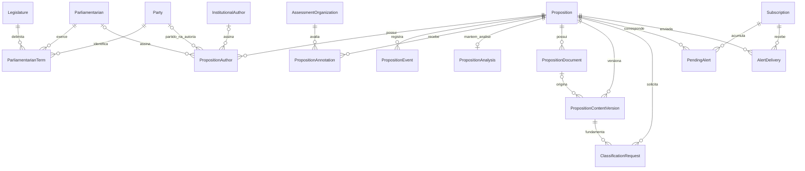

# ADR-004: Estrutura relacional do banco e projeções de leitura

## Estado e contexto

**Implementada. Registro consolidado em 08/10/2026.** Incorpora a decisão de
leitura do explorer anteriormente registrada na ADR-003.

O domínio reúne proposições de duas casas, autorias, mandatos, eventos oficiais,
avaliações humanas e resultados de IA. Esses registros possuem identidades e
ciclos de atualização distintos. Também é necessário acompanhar trabalho
assíncrono e preservar o conteúdo de relatórios já preparados.

## Decisão

Usar PostgreSQL com models e migrações Django como definição versionada do schema.
O Compose utiliza PostgreSQL 16 com pgvector. A migração de infraestrutura instala
`pg_trgm`, `unaccent`, `btree_gin`, `btree_gist` e `vector`, além de funções SQL.
A presença de extensões não significa que cada recurso tenha um pipeline ativo:
hoje só `unaccent` é usada, na busca de proposições, e nenhuma migração cria
índices GIN, GiST, trigram ou vetoriais.

Separar o domínio nos seguintes conjuntos:

| App | Responsabilidade persistida |
| --- | --- |
| `legislatures` | Legislaturas, pessoas, mandatos, partidos, autores institucionais e proveniência de perfis |
| `propositions` | Proposição, eventos, autorias, relatores, documentos, versões de texto, pedidos de IA, análise e anotações humanas |
| `taxonomy` | Temas, etiquetas e relações entre proposições |
| `committees` | Comissões, frentes, bancadas, integrantes e proveniência dos vínculos |
| `activity` | Votações, votos, sessões, presenças e discursos |
| `norms` | Normas e vínculos de alteração por proposições |
| `ingestion` | Termos de relevância, execuções, itens e checkpoints de cobertura |
| `subscriptions` | Inscrições, pendências e registros de entrega |
| `newsletters` | Relatório congelado e estado da entrega do rascunho |

As tabelas de autenticação, administração e Celery complementam o domínio. Uma
tabela existente não comprova que sua coleta esteja implementada ou preenchida.
`core` não tem models, mas mantém as migrações de extensões e de remoção do
Wagtail. O inventário completo por app está em
[banco-de-dados.md](../banco-de-dados.md).

### Relações centrais

O diagrama usa nomes de models; tabelas sem `db_table` explícito recebem o nome
padrão do Django. Cada linha de autoria deve apontar para ao menos um parlamentar
ou autor institucional; a restrição atual também permite preencher ambos.

`Proposition.current_content` seleciona a versão utilizada na análise;
`PropositionAnalysis.content_version` identifica a versão do resultado.
`DailyDigestDelivery` identifica uma entrega por e-mail/data e `WeeklyReport`
guarda um snapshot JSON, sem depender de FKs para reconstruir a edição.

### Identidade e integridade

- Proposição: unicidade por `(house, external_id)`. Número/ano não substituem a
  identidade da fonte. `is_approved` representa curadoria pública e começa falso.
- Autoria: restrição exige ao menos um parlamentar ou autor institucional;
  partido e UF na autoria preservam o contexto daquele registro.
- Evento: identidade por proposição e identificador da fonte, quando disponível;
  índices permitem consulta por proposição/data. `event_at` registra atividade
  legislativa; `updated_at` não substitui essa data.
- Documento: único por proposição/chave da fonte. Versão: única por proposição,
  documento, hash do texto e revisão, tratando nulos como iguais na restrição.
- Pedido de IA: único por proposição, hash do conteúdo e hash da configuração.
  Análise automática e anotações humanas ficam em modelos distintos.
- Pendência e entrega de alerta: únicas por inscrição/proposição. Resumo diário:
  único por endereço/data. Relatório: único por publicação/data inicial.

### Leitura do explorer

`explorer_source.py` considera apenas proposições aprovadas de tipos públicos e
monta uma projeção em cinco consultas quando há proposições:
proposições/análise, agregados de eventos, anotações, autorias e temas. Usa
`values`/agregações, evitando carregar PDFs, payloads e históricos completos como
objetos Django ou multiplicar linhas em um único JOIN de todas as relações.

O explorer e seu CSV compartilham essa fonte. Filtros e painéis são calculados no
servidor sobre a coleção; a paginação não limita os totais. Redis mantém o snapshot
`activity:explorer:source:v3` por 300 segundos. A data local obriga reconstrução
quando muda o dia. Sinais de gravação de `Proposition`, `PropositionAnnotation`,
`PropositionAnalysis`, `Parliamentarian` e `PropositionAuthor`, além de chamadas
explícitas na ingestão, invalidam `activity:*`; excluir uma anotação também
invalida. Temas, vínculos de tema, partidos, autores institucionais,
organizações avaliadoras e eventos são invalidados pelo admin, e não por signals,
porque a ingestão os grava em lote e já invalida ao fim de cada lote. Alterações
fora desses caminhos, como `QuerySet.update()` ou scripts no shell, aguardam o
TTL. Sem `delete_pattern` (LocMem nos testes), só uma lista fixa de chaves é
removida.

## Alternativas e consequências

Uma tabela única misturaria fonte, revisão humana e resultado automático. A
separação permite atualizar cada dimensão e auditar suas origens, ao custo de
mais relações e estados persistidos. JSON preserva payloads/snapshots; chaves e
restrições relacionais continuam responsáveis pela identidade operacional.

A projeção específica substitui o carregamento amplo usado anteriormente no
explorer. Não é uma materialized view: ainda percorre a coleção em Python e não
possui trava contra reconstruções simultâneas. Redis não é a fonte de verdade.

`PropositionEmbedding.embedding` permanece `BinaryField` nos models e na migração
inicial; nenhuma migração converte a coluna para `vector` nem cria índice
vetorial.
Este registro não considera busca vetorial ou geração de embeddings um fluxo
implementado. Dumps antigos de schema não substituem as migrações atuais.

## Referências da implementação

- [Models das proposições](../../apps/propositions/models.py), [legislaturas](../../apps/legislatures/models.py) e [taxonomia](../../apps/taxonomy/models.py).
- [Extensões PostgreSQL](../../apps/core/migrations/0001_extensions.py) e [migrações das proposições](../../apps/propositions/migrations/).
- [Models de ingestão](../../apps/ingestion/models.py), [alertas](../../apps/subscriptions/models.py) e [relatórios](../../apps/newsletters/models.py).
- [Projeção do explorer](../../apps/propositions/explorer_source.py), [cache e filtros](../../apps/propositions/explorer.py) e [testes do explorer](../../tests/integration/test_activity_explorer_api.py).
- [ADR-002: ingestão e IA](002-daily-ingestion-content-versions.md) e [ADR-005: alertas](005-sistema-de-alertas.md).
