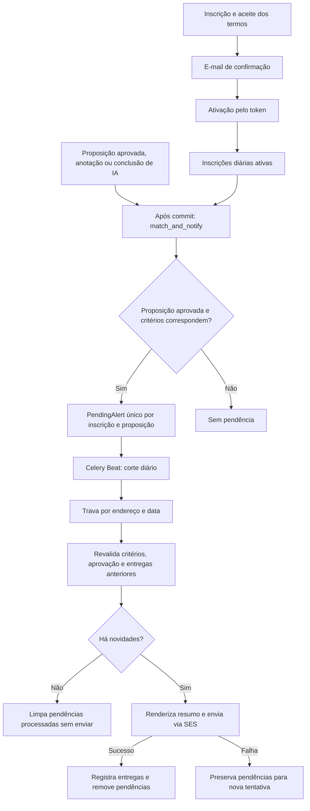

# ADR-005: Alertas por critérios persistidos e resumo diário por e-mail

## Estado e contexto

**Implementada. Registro consolidado em 08/10/2026.**

Assinantes precisam acompanhar proposições por filtros combináveis, confirmar o
endereço e receber novidades sem um e-mail por correspondência. Ingestão, curadoria
e avaliações ocorrem em momentos diferentes; o envio deve sobreviver a reinícios
e revalidar a elegibilidade antes de usar uma pendência antiga.

## Decisão

Persistir os critérios em `Subscription.ast` e sua compilação textual em
`query`, convertida para `tsquery` na consulta PostgreSQL. `build_document`
produz tokens estruturados por campo, e `array_to_tsvector` preserva tokens como
`casa_camara`. Casos marcados com `needs_revalidation` passam também pelo avaliador
Python do AST. Esse mecanismo é distinto do filtro de relevância dos raspadores.

### Inscrição e confirmação

`POST /api/v1/subscriptions` exige e-mail, aceite dos termos e uma lista de
critérios compiláveis. Uma nova inscrição substitui as anteriores do mesmo
endereço e nasce inativa. O aceite fica registrado em `accepted_terms_at`.

O token de confirmação ativa as inscrições pendentes daquele endereço; o token
de cancelamento desativa todas as inscrições dele. Ambos são acessados por GET
nos links de e-mail. A limpeza diária remove inscrições inativas anteriores ao
TTL configurado. A rota de confirmação não verifica a idade do token diretamente;
não há garantia de expiração exata no instante do TTL.

O modelo e a API ainda aceitam `weekly` por compatibilidade, mas o fluxo de envio
seleciona somente `daily`. As tarefas semanais antigas retornam sem enviar e-mail.
A newsletter do Substack tem outro fluxo e não consome essas inscrições.

### Correspondência e envio

Gatilhos de correspondência: criação já aprovada ou transição para aprovada,
gravação de anotação humana e conclusão aplicável de classificação normal.
O backfill de avaliações usa `only_if_unevaluated` e não dispara alertas retroativos.
Uma atualização genérica de status não é, por si só, gatilho de envio.

Por padrão, o Beat dispara às **09:00 em America/Sao_Paulo**, configurável por
`DAILY_DIGEST_TIME`. O worker agrupa pendências por endereço, mesmo quando há
várias inscrições. Itens criados depois do corte ficam para o próximo dia;
pendências anteriores são recuperadas. Não há mensagem quando não há novidades.

`DailyDigestDelivery` tem unicidade por e-mail/data e é bloqueado com
`select_for_update`. `AlertDelivery` registra proposições enviadas e evita sua
repetição para o endereço enquanto esse histórico existe. A reinscrição remove
as inscrições anteriores e, por cascata, seus históricos associados.

A categoria humana tem precedência no documento de correspondência; sem categoria
humana, vale a categoria da QuitérIA com análise concluída. O resumo agrupa itens
por tema editorial e celeridade. Templates MJML são compilados no build, e Django
Anymail usa Amazon SES para enviar versões HTML e texto.

## Alternativas e consequências

O envio imediato foi substituído por pendências persistidas. Isso reduz mensagens
e permite revalidar mudanças antes da entrega, com atraso intencional até o corte.
O AST mantém critérios reproduzíveis, mas exige compatibilidade entre compilador,
documento e avaliador de referência; atributos disponíveis no schema não garantem
que todos estejam preenchidos pelo construtor de documentos.

A trava e as restrições serializam tarefas repetidas, mas SES e PostgreSQL não
compartilham uma transação. Uma queda após aceitação pelo SES e antes do commit
pode reenviar a mensagem. Não há garantia de entrega externa exatamente uma vez.
Falhas `AnymailError` têm retry com backoff, limitado a cinco retries.

## Referências da implementação

- [API](../../apps/subscriptions/api.py), [schemas](../../apps/subscriptions/schemas.py) e [models](../../apps/subscriptions/models.py).
- [Compilador](../../apps/subscriptions/compiler.py), [documento](../../apps/subscriptions/document_builder.py), [serviço](../../apps/subscriptions/service.py) e [avaliador](../../apps/subscriptions/reference_matcher.py).
- [Gatilhos](../../apps/propositions/signals.py), [tarefas de envio](../../apps/subscriptions/tasks.py) e [conclusão da IA](../../apps/ingestion/content.py).
- [Templates](../../apps/subscriptions/emails/README.md), [agenda](../../config/settings/base.py) e [testes de entrega](../../tests/integration/test_alert_delivery.py).
- [ADR-001: rascunhos do Substack](001-weekly-substack-drafts.md) e [ADR-004: banco](004-estrutura-do-banco.md).
