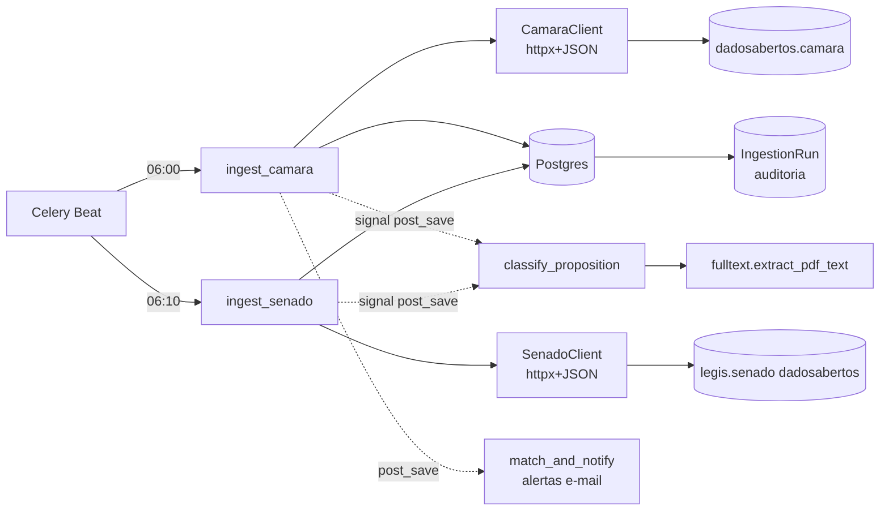
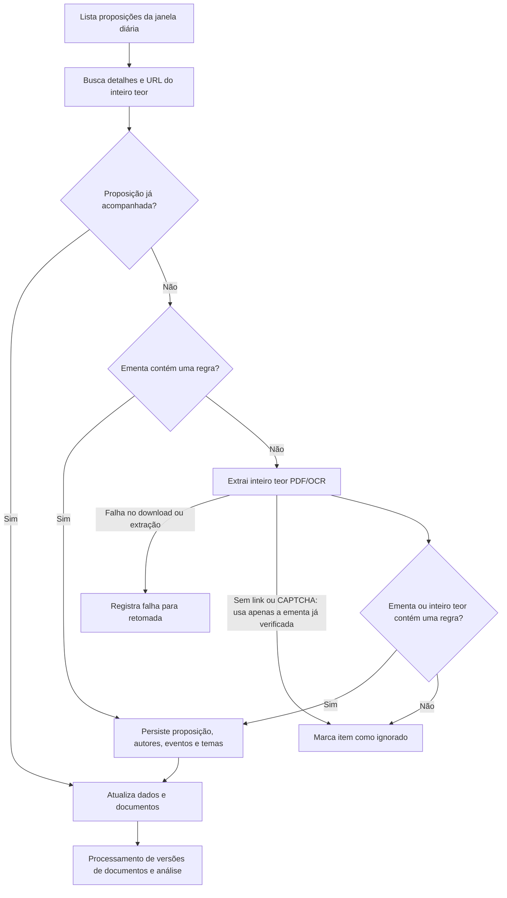
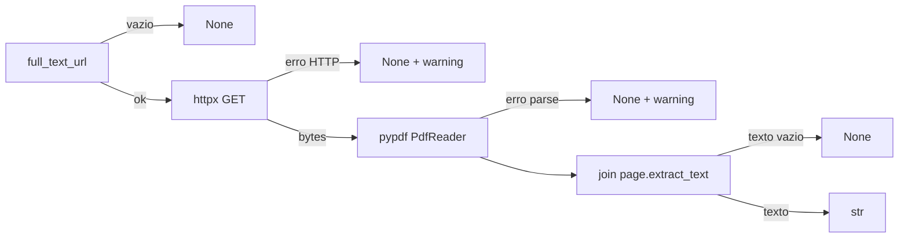

# Raspadores (Ingestion)

Coleta automática de proposições legislativas da **Câmara dos Deputados** e do
**Senado Federal**, com foco em pautas de gênero/direitos das mulheres. Substitui
o `elasnocongressobot` (Scrapy + CSV + Google Sheets) por clients HTTP + tasks
Celery gravando direto no domínio relacional (Postgres é a fonte da verdade).

App: [`apps/ingestion/`](../apps/ingestion).

---

## Sumário

- [Arquitetura](#arquitetura)
- [Fluxo da coleta](#fluxo-da-coleta)
- [URLs dos raspadores](#urls-dos-raspadores)
- [Horários (agendamento)](#horários-agendamento)
- [Filtro de tema (`theme_assert`)](#filtro-de-tema-theme_assert)
- [Extração do inteiro teor (PDF)](#extração-do-inteiro-teor-pdf)
- [Persistência e idempotência](#persistência-e-idempotência)
- [Como rodar](#como-rodar)

---

## Arquitetura

```
apps/ingestion/
├── clients/
│   ├── base.py      # httpx keep-alive + retry exponencial (tenacity)
│   ├── camara.py    # Dados Abertos Câmara (JSON)
│   └── senado.py    # Dados Abertos Senado (JSON)
├── theme_assert.py  # filtro de relevância na ementa ou inteiro teor
├── mappers.py       # payload bruto → kwargs de Proposition/Event/Author/Theme
├── resolvers.py     # autor → Parliamentarian | InstitutionalAuthor (+ sexo)
├── fulltext.py      # download + extração de texto do PDF (inteiro teor)
├── tasks.py         # orquestração Celery (ingest_camara / ingest_senado / classify)
├── models.py        # IngestionRun (auditoria de cada execução)
└── admin.py         # IngestionRun read-only (Unfold)
```

Decisões de projeto:

- **Sem Scrapy**: os "spiders" eram só 2–3 GETs encadeados em APIs REST/XML
  oficiais. Trocados por `httpx` + JSON dentro de tasks Celery — zero dependência
  de peso.
- **Postgres como fonte da verdade** (Google Sheets descontinuado).
- **ML desacoplado da coleta**: a coleta grava `Proposition`; um signal enfileira
  `classify_proposition`. Falha de ML não bloqueia ingestão. Hoje a classificação
  é um stub (loga) que já baixa/extrai o inteiro teor — a inferência em si está
  pendente de decisão (HF endpoint / fila dedicada / local).
- **Filtro na ementa ou inteiro teor**: candidatos sem correspondência na ementa
  exigem leitura do documento antes de serem descartados.



---

## Fluxo da coleta

Cada casa roda em uma task independente. A descoberta de novas proposições usa
ementa ou inteiro teor; atualizações de proposições conhecidas preservam o acompanhamento.



Falhas por item são registradas e retomáveis. Uma execução com falhas não avança
o checkpoint de cobertura; resultados negativos só são registrados após a
verificação do texto disponível ter sido concluída.

### Saltos por casa

| Casa | Passo 1 (lista) | Passo 2 (detalhe) | Passo 3 (autores) | Passo 4 (inteiro teor) |
|------|-----------------|-------------------|-------------------|------------------------|
| **Câmara** | `/proposicoes` (paginado) | `/proposicoes/{id}` | `/proposicoes/{id}/autores` + `/deputados/{id}` | `urlInteiroTeor` (do detalhe) |
| **Senado** | `/materia/tramitando` | `/materia/{id}` | `/materia/autoria/{id}` | `/materia/textos/{id}` → PDF |

---

## URLs dos raspadores

### Câmara — `https://dadosabertos.camara.leg.br/api/v2`

| Método (client) | Endpoint | Uso |
|-----------------|----------|-----|
| `list_propositions(start, end)` | `GET /proposicoes?dataInicio={start}&dataFim={end}&ordem=ASC&ordenarPor=id&itens=100` | lista paginada da janela (segue `links.rel=next`) |
| `fetch_detail(id)` | `GET /proposicoes/{id}` | status, urls, `urlInteiroTeor`, ementa detalhada, keywords |
| `fetch_authors(id)` | `GET /proposicoes/{id}/autores` | autores (nome, tipo, uri) |
| `fetch_deputy(id)` | `GET /deputados/{id}` | `sexo`, `ultimoStatus.siglaPartido`, `siglaUf` |

### Senado — `https://legis.senado.leg.br/dadosabertos`

| Método (client) | Endpoint | Uso |
|-----------------|----------|-----|
| `list_materias(day)` | `GET /materia/tramitando?data=YYYYMMDD` | matérias em tramitação no dia |
| `fetch_detail(id)` | `GET /materia/{id}` | dados básicos, ementa, autor (texto livre) |
| `fetch_movements(id)` | `GET /materia/movimentacoes/{id}` | situação atual / último evento |
| `fetch_authors(id)` | `GET /materia/autoria/{id}` | autores com `CodigoParlamentar`, `SexoParlamentar`, `SiglaPartidoParlamentar`, `UfParlamentar` |
| `fetch_texts(id)` | `GET /materia/textos/{id}` | documentos (inteiro teor) |

### Documentos (PDF)

| Origem | Padrão de URL |
|--------|----------------|
| Câmara | `urlInteiroTeor` do detalhe (varia por proposição) |
| Senado | `http://legis.senado.leg.br/sdleg-getter/documento?dm={CodigoTexto}` |

> **Headers**: `User-Agent` próprio + `Accept: application/json`. Conexão keep-alive
> por client. Retry exponencial (tenacity) em erros de transporte/HTTP: 3 tentativas,
> espera 2→4→…→30s.
>
> ⚠️ O serviço `/materia/autoria` do Senado está marcado como **deprecated**
> (desativação anunciada 2026-02-01) mas segue ativo. Há fallback: se vier vazio,
> os autores são extraídos do texto livre do detalhe (mantém partido/UF, perde o
> sexo).

---

## Horários (agendamento)

Agendado pelo **Celery Beat** (`DatabaseScheduler`), definido em
[`config/settings/base.py`](../config/settings/base.py) → `CELERY_BEAT_SCHEDULE`.
Fuso: **`America/Sao_Paulo`** (`CELERY_TIMEZONE`).

| Task | Cron | Janela coletada |
|------|------|-----------------|
| `apps.ingestion.tasks.ingest_camara` | `06:00` (diário) | ontem → amanhã |
| `apps.ingestion.tasks.ingest_senado` | `06:10` (diário) | dia corrente (`/tramitando?data=hoje`) |

A janela ontem→amanhã (Câmara) absorve fusos/atrasos de publicação, igual ao bot
original. Coleta é **incremental** (não varre histórico) — backfill é processo
separado.

---

## Filtro de tema (`theme_assert`)

[`apps/ingestion/theme_assert.py`](../apps/ingestion/theme_assert.py) verifica
**ementa ou inteiro teor** para descobrir novas proposições, tanto na Câmara
quanto no Senado. Os registros das APIs continuam sendo coletados por janela de
datas; a seleção por palavras ocorre localmente.

Os termos ficam na tabela `relevance_terms`, editável no admin em
`Coleta de dados → Termos de relevância`. A migração `0005` ativa o vocabulário
solicitado em outubro de 2026: **298 expressões isoladas e 4 combinações**.
Registros anteriores fora da lista ficam inativos para consulta. A migração não
é reversível, pois não seria possível reconstruir com segurança o estado das
edições anteriores no admin. A lista padrão está em
[`relevance_defaults.py`](../apps/ingestion/relevance_defaults.py); é usada quando
não há registros ativos ou a consulta ao banco falha. Alterações posteriores no
arquivo não substituem os registros do banco: exigem outra migração de dados.

Regras de correspondência:

- Palavras inteiras, sem diferenciar maiúsculas/minúsculas, preservando acentos.
  `TRANS` e `TRANSGEN` não correspondem a `TRANSGÊNICA` nem a `TRANSGENERO`.
  Variações e plurais precisam constar na lista.
- Expressões completas, contíguas e na mesma ordem: `ABUSO SEXUAL` aceita
  espaços ou quebras de linha entre as palavras, mas não `ABUSO DE NATUREZA SEXUAL`.
  Uma expressão nunca é formada juntando o final da ementa ao início do PDF.
- `COTAS + MULHERES`, `COTAS + GÊNERO`, `POLÍTICA + MULHERES` e
  `POLÍTICA + MULHER` exigem ambas as expressões, em qualquer ordem, nos campos
  consultados. O `+` final de `LGBTQIA+` é literal. Termos combinados antigos
  cadastrados sem ` + ` continuam exigindo `MULHER`, por compatibilidade.
- Cada regra é uma alternativa: qualquer uma basta. Por exemplo, `MULHERES`
  também é uma regra isolada, independentemente da combinação com `COTAS`.
- `ENTREGA VOLUNTÁRIA` corrige apenas a quebra de linha da lista recebida;
  as demais grafias foram preservadas, inclusive `SÊMEM`.

Fluxo de descoberta:

1. Busca os detalhes para obter a ementa e a URL do documento original.
2. Verifica a ementa (incluindo a ementa detalhada da Câmara). `keywords` de
   indexação não qualificam uma proposição por conta própria.
3. Sem correspondência, baixa e extrai o inteiro teor com o extrator PDF/OCR
   existente, antes de decidir pela exclusão. O texto positivo é persistido.
4. Se ambos não tiverem correspondência, marca o item como ignorado.
   Download malsucedido ou extração vazia são falhas retomáveis, não resultados
   negativos. Seguem as tentativas e a retomada já existentes da coleta; uma
   execução com falhas não avança a cobertura da janela.
5. Se não houver link do documento ou ele devolver uma página HTML de CAPTCHA/
   verificação de segurança, decide apenas pelas ementas disponíveis. Com
   correspondência, a proposição é incluída normalmente. Sem correspondência nelas,
   o item é ignorado, sem erro nem novas tentativas nessa execução. O fallback é
   registrado em log informativo. Isso permite concluir a coleta, mas pode deixar
   de descobrir matérias relevantes apenas no inteiro teor. HTML genérico,
   erros de rede e PDFs inválidos continuam sendo falhas retomáveis.

Uma correspondência na ementa dispensa a extração síncrona; o processamento de
versões de documentos continua pela fila existente. Esse processamento também
verifica o documento após a descoberta por inteiro teor. Proposições já
acompanhadas continuam sendo atualizadas sem reaplicar o filtro de descoberta.
A leitura de PDFs de candidatos antes descartados aumenta o custo da coleta.
Não há reprocessamento automático de itens ignorados em execuções históricas.

### Temas no domínio

Os termos detectados (`temas`) viram `Theme` + `PropositionTheme` (com `rank`).
O `Theme.slug` é gerado por slugify do termo; reaproveita temas já existentes
(`get_or_create`). Exemplos de temas que aparecem no domínio:
`Violência Contra a Mulher`, `Lei Maria da Penha`, `Feminicídio`,
`Direitos Sexuais e Reprodutivos`, `Maternidade`, `Raça`, `Igualdade de Gênero`.

> A classificação temática/posicional por **ML** (modelos `azmina/*`) é separada e
> está como stub — ver `classify_proposition`. O `theme_assert` é o filtro
> determinístico por palavra-chave, não o classificador.

---

## Extração do inteiro teor (PDF)

[`apps/ingestion/fulltext.py`](../apps/ingestion/fulltext.py) — porta o
`textfrompdf` do bot, trocando `requests`+`PyPDF2` por `httpx`+`pypdf`.

```python
from apps.ingestion.fulltext import extract_pdf_text

texto = extract_pdf_text("http://legis.senado.leg.br/sdleg-getter/documento?dm=9904701")
# str com o texto extraído, ou None em qualquer falha
```

Comportamento:

- `url` vazio/None → `None`.
- Baixa o PDF (httpx, `User-Agent` de navegador, `follow_redirects`, timeout 60s).
- Erro HTTP/transporte → loga warning e retorna `None`.
- Extrai texto de todas as páginas via `pypdf` (`page.extract_text()`).
- PDF corrompido / sem texto extraível → `None` (não levanta exceção).



### Seleção do PDF no Senado

O Senado expõe vários documentos por matéria. `pick_senado_full_text_url`
(em `mappers.py`) escolhe o **texto inicial** da proposição:

1. filtra só PDFs (`FormatoTexto == application/pdf`);
2. prioriza **não-derivados** (exclui relatório, parecer, emenda, voto, redação,
   substitutivo, errata);
3. entre os não-derivados, pega o **mais antigo** (apresentação).

O resultado vai para `Proposition.full_text_url`, equivalendo ao `urlInteiroTeor`
da Câmara. O `classify_proposition` então baixa/extrai esse PDF.

---

## Persistência e idempotência

`_persist` (em `tasks.py`) faz upsert idempotente numa transação:

- `Proposition.update_or_create(house, external_id)` — re-coletar não duplica.
- `raw_payload` (JSONField) guarda o payload cru → reprocessável sem re-raspar.
- `PropositionEvent` (último evento), `PropositionAuthor` (recriados a cada coleta,
  com partido/UF e sexo resolvidos), `PropositionTheme` (temas do `theme_assert`).
- Autores resolvidos por `resolve_author`: existente via `ParliamentarianTerm`
  (por `external_id`), institucional (`InstitutionalAuthor`) ou parlamentar mínimo
  criado pelo nome. Sexo grava em `Parliamentarian.gender` (com backfill quando vazio).

Cada execução registra um `IngestionRun` (casa, janela, status, contadores
`fetched/relevant/upserted/errors`) — visível no admin (read-only).

---

## Como rodar

```bash
# infra
docker compose up -d postgres redis
uv run python manage.py migrate

# worker + agendador
uv run celery -A config worker -l info
uv run celery -A config beat -l info

# disparo manual
uv run python manage.py shell -c "from apps.ingestion.tasks import ingest_senado; ingest_senado.delay()"
```

### Testes

```bash
uv run pytest apps/ingestion/tests/ --no-migrations \
  --cov=apps/ingestion --cov-report=term-missing --cov-fail-under=95
```

> `--no-migrations` é necessário: as apps de domínio não têm migrations commitadas;
> o pytest-django cria o schema direto dos models. Fixtures reais (capturadas das
> APIs) ficam em `apps/ingestion/tests/fixtures/`.
