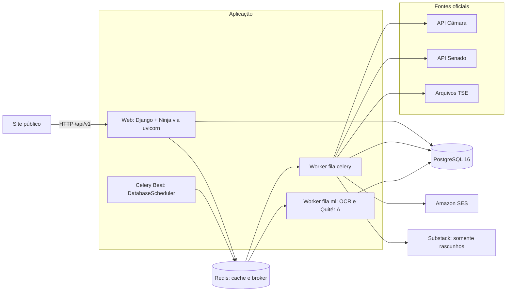

# Visão geral da arquitetura

A API do Elas no Congresso coleta proposições da Câmara dos Deputados e do
Senado Federal, filtra as relacionadas a gênero, classifica-as com a QuitérIA,
publica os dados curados para o site e envia alertas por e-mail. Também prepara
rascunhos semanais no Substack para revisão editorial.

## Componentes

| Processo | Comando | Função |
| --- | --- | --- |
| `web` | `uvicorn config.asgi:application` | API pública, admin, health checks e assets de e-mail |
| `worker` | `celery -A config worker -Q celery` | Ingestão, reconciliação, enriquecimento, alertas e newsletter |
| `ml-worker` | `celery -A config worker -Q ml` | Download/extração de documentos, OCR e inferência QuitérIA |
| `beat` | `celery -A config beat -S django` | Agenda persistida no banco (`django-celery-beat`) |

Redis é cache (`django-redis`) e broker; resultados de tarefas ficam no banco
(`django-celery-results`). As rotas de fila estão em `CELERY_TASK_ROUTES`: só
`check_proposition_document`, `run_classification_request` e
`classify_proposition` vão para `ml`.

## Apps Django

| App | Responsabilidade |
| --- | --- |
| `core` | Enums compartilhados, extensões PostgreSQL, tema do admin e `profile_activity_explorer` |
| `legislatures` | Legislaturas, partidos, parlamentares, mandatos, perfis por fonte, autores institucionais; API de parlamentares |
| `propositions` | Proposições, eventos, autorias, relatorias, documentos, versões de texto, IA, anotações; APIs de atividade, explorer, dataset e estatísticas |
| `taxonomy` | Temas, etiquetas e relações entre proposições; API de categorias |
| `committees` | Comissões, frentes, bancadas e vínculos com proveniência |
| `activity` | Votações, votos, sessões, presenças e discursos (schema sem coleta ativa) |
| `norms` | Normas jurídicas e alterações por proposições |
| `ingestion` | Clientes das fontes, sincronização, relevância, OCR, versões de conteúdo, backfill de avaliações |
| `subscriptions` | Inscrições, compilador de critérios, correspondência, resumo diário por e-mail |
| `newsletters` | Relatório semanal congelado e entrega de rascunho ao Substack |

## Ciclo diário

Horários em `America/Sao_Paulo`, conforme `CELERY_BEAT_SCHEDULE`
(`config/settings/base.py`).

| Horário | Etapa |
| --- | --- |
| 03:00 | Sincronização e enriquecimento de perfis parlamentares |
| 04:00 | Limpeza de inscrições inativas |
| 06:00 / 06:10 | Ingestão incremental Câmara / Senado |
| 06:30 | Reconciliação do inventário |
| 06:45 | Backfill de avaliações ausentes |
| 09:00 | Resumo diário por e-mail (`DAILY_DIGEST_TIME`) |

`recover_pending_content` roda a cada 15 minutos. Com
`WEEKLY_NEWSLETTER_ENABLED=True`, as segundas-feiras recebem também as tarefas
do Radar (04:00, 06:35, 06:45 e 07:00). A agenda completa está em
[operacao.md](operacao.md#agenda-do-celery-beat).

## Fluxo de dados

1. **Coleta** ([ingestao.md](ingestao.md)): proposições novas passam pelo filtro
   de relevância; as já conhecidas são atualizadas sem filtro.
2. **Conteúdo e IA**: documentos geram versões de texto; cada texto novo produz
   um pedido único de classificação no worker `ml`.
3. **Curadoria** ([admin.md](admin.md)): a equipe aprova (`is_approved`) e anota
   proposições. Só proposições aprovadas e de tipos públicos aparecem na API.
4. **Publicação** ([api.md](api.md)): o site consome `/api/v1`, com cache Redis
   de 5 minutos nos endpoints de atividade.
5. **Alertas** ([alertas.md](alertas.md)): aprovação, anotação ou classificação
   concluída geram pendências; o resumo diário as envia por SES.
6. **Radar semanal** ([newsletter.md](newsletter.md)): snapshot congelado vira
   rascunho no Substack.

## Regras de domínio transversais

### Avaliação exibida

Implementada em `apps/propositions/activity.py`:

- anotação humana tem precedência; havendo mais de uma, prevalece a
  desfavorável;
- sem anotação, vale a análise QuitérIA com status `succeeded`
  (`classification` 0 = favorável, 1 = desfavorável), exibida com a organização
  "QuitérIA";
- sem nenhuma das duas, a proposição fica "sem avaliação".

### Celeridade

Calculada em `apps/propositions/celerity.py` a partir dos eventos contáveis:

| Condição (avaliada em ordem) | Rótulo |
| --- | --- |
| 360 dias ou mais sem movimentação | Esquecida |
| 180 dias ou mais | Travada |
| 90 dias ou mais | Lenta |
| 3 ou mais movimentações nos últimos 90 dias | Tá voando |
| Demais casos | Rápida |

Por depender da data atual, o snapshot do explorer é reconstruído quando o dia
muda.

### Tipos públicos

`PUBLIC_LEGISLATIVE_TYPES`: PEC, PL, PLP, PLV, PDC, PRC, PLS, PLN, PRS e PDS.

### Categorias 2026

Enum `PropositionCategory` (`apps/core/enums.py`), na ordem dos índices do modelo
temático: `direitos_sexuais_reprodutivos`, `educacao_cultura`,
`familia_parentalidade`, `igualdade_antidiscriminacao`,
`infancia_adolescencia`, `lgbtqiapn`, `participacao_politica`, `saude`,
`trabalho_economia_cuidado`, `violencias_de_genero`.

## Pilha técnica

- Python 3.12, gerenciado por `uv`; Django 5.1, Django Ninja, django-unfold.
- PostgreSQL 16 com pgvector (imagem `pgvector/pgvector:pg16`), Redis 7.
- Celery 5 com `django-celery-beat` e `django-celery-results`.
- `httpx` e `tenacity` para as fontes; `pypdf`, PyMuPDF e Tesseract (`por`) para
  documentos.
- PyTorch 2.12 (CPU) e Transformers 5.7 para a QuitérIA 2.0.
- django-anymail com Amazon SES v2; templates MJML compilados no build.
- `python-substack==0.9.1` isolado por um adaptador somente-rascunho.
- Deploy com Kamal 2 em imagem distroless.
